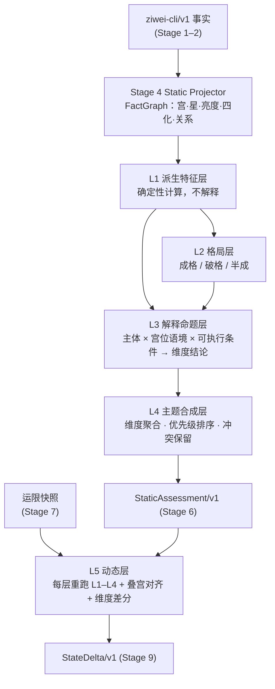

# 紫微斗数解读知识模型设计

> 状态：设计稿；M1（L1 派生特征层 + 可执行修正项）已实现，见 §16
> 日期：2026-11-03
> 上游：`ziwei-cli/v1`（`scripts/ziwei_cli.cjs`，`iztro@2.5.8`）
> 配套：[`tasks/prd-ziwei-forward-reasoning-pipeline.md`](../tasks/prd-ziwei-forward-reasoning-pipeline.md)、[`tasks/ziwei-forward-reasoning-pipeline-stage-contracts.md`](../tasks/ziwei-forward-reasoning-pipeline-stage-contracts.md)、[`knowledge/ziwei/README.md`](../knowledge/ziwei/README.md)

## 1. 目的与范围

正向推理 PRD 已经定义了 Stage 0–12 的执行顺序、门禁和契约，但没有定义「解读知识本身长什么样」。本文补上这一块：在盘面事实（Stage 4 FactGraph）和结论单元（Stage 10）之间，命理知识应如何分层、表示、组合和求值。

本文解决：

- 星曜、宫位、四化、辅煞如何组合成可判断的「结构」；
- 解释命题如何表达，修正项如何从文字变为可执行条件；
- 多条命题如何在不打分、不临场调和的前提下合成主题状态；
- 大限、流年如何复用同一套知识，产出相对本命的状态变化；
- 两本参考资料分别提取哪些内容、进入哪一层。

本文不改变 PRD 的任何门禁原则：CLI 是唯一盘面事实源；LLM 只做转写；线上只用 `reviewed` 且有视觉复核来源的知识；`feixing-aux` 不覆盖 `sanhe-core`。

## 2. 现状与问题

### 2.1 已有资产

| 资产 | 位置 | 状态 |
| --- | --- | --- |
| 排盘 CLI | `scripts/ziwei_cli.cjs` | 输出十二宫、主/辅/杂曜、亮度、生年四化、宫干支、对宫与三合、运限快照 |
| 关系与运限规则 | `knowledge/ziwei/rules/` | 宫位关系、斗君、流期、各层四化作用域（p408–409） |
| 解释命题 | `knowledge/ziwei/interpretations/` | 5 条宫位、14 条主星、4 条四化 |
| 报告模板 | `knowledge/ziwei/reports/*.yaml` | 每主题定义 `palace_priority` 与阅读顺序 |
| 证据组装 | `scripts/ziwei_report_evidence.cjs` | 事实投影 + 命题匹配 + 证据绑定 |
| 原书摘录 | `knowledge/ziwei/sources/*/excerpts.jsonl` | 《命理天机》23 条、《飞星紫微斗数》5 条，均已视觉复核 |

### 2.2 问题

**P1：命题粒度停在「单星存在」。** 14 条主星命题的条件都是 `{"feature": "palace_has_star", "star": X}`，不约束宫位。每张盘都含全部 14 颗主星，命题实际只靠报告模板的 `palace_priority` 过滤，「天机在官禄」与「天机在夫妻」得到相同解释。

**P2：修正项不可执行。** `modifiers.strengthen/weaken` 是自然语言（如「庙旺且获辅弼或禄权科会照时……」），`ziwei_report_evidence.cjs` 不对其求值。原书反复强调星曜和四化不能脱离落宫、庙陷与会照判断（《命理天机》p416；《飞星紫微斗数》p249–250），这条方法论目前没有落地。

**P3：缺少「结构」层。** 紫微解读的基本单位是星系组合、三方四正会照、格局、夹宫、空宫借星、宫干飞化和运限叠宫，而不是孤立的星。现有模型没有这些概念。

**示例。** 测试盘 1990-05-15 10:30 男（虚构）：

| 宫位 | 主星 | 辅煞 |
| --- | --- | --- |
| 命宫（戊子） | 破军庙 | — |
| 财帛宫（甲申） | 七杀庙 | 禄存、天马、铃星 |
| 官禄宫（庚辰） | 贪狼庙 | 地劫 |
| 迁移宫（壬午） | 廉贞平、天相庙 | 地空、火星 |

现有模型输出「破军 base / 七杀 base / 贪狼 base」三条互不相关的通用倾向。命宫三方构成的杀破狼结构、官禄见地劫、对宫见空火，均无法识别，也无法作用于结论。

## 3. 总体模型



### 3.1 与 Pipeline Stage 的对应

| 本文层级 | 落入 Stage | 性质 | 产物 |
| --- | --- | --- | --- |
| L1 派生特征 | Stage 4 之后、Stage 5 之前（新增 4D Feature Deriver） | 确定性代码 + 方法论规则 | `ZiweiFeatureSet/v1` |
| L2 格局 | Stage 5 前半 | 规则引擎 | `PatternMatch[]` |
| L3 解释命题 | Stage 5 | 规则引擎（条件匹配 + 修正项求值） | `MatchedProposition[]`（扩展） |
| L4 主题合成 | Stage 6 | 结构化聚合 | `StaticAssessment/v1`（扩展） |
| L5 动态 | Stage 7–9 | 复用 L1–L4 + 差分 | `ActivationSet/v1`、`StateDelta/v1` |

L1 是新增子阶段；其余层扩展现有 Stage 的输入输出契约，不改变状态图结构和门禁位置。

### 3.2 层间不变量

1. L1 只产出事实性特征（「三方见地劫」），不产出吉凶或倾向。
2. L2 只判定格局成立状态，不产出用户语言。
3. L3 是唯一把知识 claim 绑定到盘面的层（与 PRD「Stage 5 唯一绑定」一致）。
4. L4 只做归组、排序和冲突标注，不生成新 claim。
5. L5 不另立一套「流年知识」，优先复用 L1–L4；只有差分无法表达的情况才使用专门的动态命题。

## 4. L1 派生特征层

### 4.1 职责

把 FactGraph 中分散的宫、星、亮度、四化和关系，计算成命题条件可以直接引用的特征。所有特征：

- 由代码确定性计算，相同盘面得到相同结果；
- 带 `feature_id`、`scope`（natal / decadal / yearly）、`origin.fact_ids`（追溯到 FactGraph）；
- 计算方法本身登记为 `rule_type: derivation` 规则，绑定方法论来源。没有来源支持的计算方法标记为 `iztro-default` 或 `pending_source`，不得进入线上命题条件。

### 4.2 特征清单（v1）

| 特征 | 定义 | 计算依据 | 来源状态 |
| --- | --- | --- | --- |
| `palace_star_system` | 宫内主星的有序组合，如 `廉贞+天相`；无主星记为 `empty` | `natal.palaces[].major_stars` | 星情总论各章（已有） |
| `empty_palace_borrow` | 空宫时引用对宫星系，`borrowed_from` 指向对宫 | 对宫关系 | **待补摘录** |
| `brightness_state` | 庙 > 旺 > 得 > 利 > 平 > 不 > 陷 归一为有序枚举 | CLI `brightness` | p249「得地/不得地」（已有，需补亮度等级摘录） |
| `relation_set` | 某宫的本宫、对宫、三合、邻宫集合（复用现有 `palace-relations.yaml`） | CLI `relations` | p250（已有） |
| `sanfang_aggregate` | 某宫三方四正内的吉星、煞星、四化清单，每项保留所在宫与关系类型 | `relation_set` + 星曜分类 | p250「正、合、拱」（已有）；星曜吉煞分类**待补摘录** |
| `jia_palace` | 邻宫两侧星曜构成的夹，如 `左辅/右弼` 夹、`擎羊/陀罗` 夹 | 邻宫 | p250「夹前后」及本宫对夹宫的修正（已有） |
| `flying_mutagen` | 宫干四化：某宫干使某星化禄权科忌，落入何宫；派生 `self`（自化）、`clash_palace`（化忌所入宫的对宫） | 宫干 + `iztro` 的 `getMutagensByHeavenlyStem` | p249 方法论（已有）；飞化细则**待补摘录** |
| `mutagen_stack` | 同一宫或同一星在多个时间层同时化忌、化禄等的叠加 | 本命 + 运限四化 | p409 作用域（已有） |
| `overlay_map` | 运限十二宫与本命十二宫的映射，如「大限官禄 = 本命迁移」 | 运限 `palace_keys` | p417（摘录**待入库**） |

### 4.3 星曜分类本体

`sanfang_aggregate` 依赖星曜的类别。新增 `knowledge/ziwei/ontology/stars.yaml`：

```json
{
  "schema_version": "ziwei-ontology/stars/v1",
  "groups": {
    "major": ["紫微", "天机", "太阳", "武曲", "天同", "廉贞", "天府", "太阴", "贪狼", "巨门", "天相", "天梁", "七杀", "破军"],
    "auspicious_six": ["左辅", "右弼", "文昌", "文曲", "天魁", "天钺"],
    "malefic_six": ["擎羊", "陀罗", "火星", "铃星", "地空", "地劫"],
    "lucun": ["禄存"],
    "horse": ["天马"]
  },
  "evidence": ["pending_source"]
}
```

分组本身是解读口径，必须有来源；在补齐摘录前保持 `status: extracted`，只供测试使用。CLI 输出中的 `type`（`soft`、`tough`、`lucun` 等）只作为交叉校验，不作为分组依据。

### 4.4 输出契约 `ZiweiFeatureSet/v1`

```json
{
  "schema_version": "ziwei-feature-set/v1",
  "scope": "natal",
  "features": [
    {
      "feature_id": "feat.natal.ming.star_system",
      "feature": "palace_star_system",
      "palace": "命宫",
      "value": ["破军"],
      "origin": {"fact_ids": ["fact.ming.pojun"]}
    },
    {
      "feature_id": "feat.natal.guanlu.sanfang",
      "feature": "sanfang_aggregate",
      "palace": "官禄宫",
      "value": {
        "malefic": [{"star": "地劫", "palace": "官禄宫", "relation": "self"}],
        "auspicious": [],
        "mutagens": [{"star": "武曲", "mutagen": "权", "palace": "夫妻宫", "relation": "trine"}]
      },
      "origin": {"fact_ids": ["fact.guanlu.dijie", "fact.fuqi.wuqu.quan"]},
      "method_rule": "rule.derivation.sanfang-aggregate.v1"
    }
  ]
}
```

## 5. L2 格局层

### 5.1 为什么单独成层

格局是「多个条件同时成立」才构成的结构，有独立的成格条件和破格条件，原书也通常把格局与单星论述分章处理。混进单星命题会导致：同一组事实被多条命题重复解释；成格与破格无法单独审核证据。

### 5.2 格局规则 Schema（草案）

```json
{
  "id": "pattern.shapolang.v1",
  "name": "杀破狼",
  "school": "sanhe-core",
  "status": "draft_ocr",
  "anchor_palace": "命宫",
  "requires": {
    "all": [
      {"feature": "sanfang_contains_systems", "palace": "命宫", "systems_any_order": ["七杀", "破军", "贪狼"]}
    ]
  },
  "breaks": {
    "any": [
      {"feature": "sanfang_aggregate.malefic.count", "palace": "命宫", "operator": ">=", "value": 2},
      {"feature": "star_mutagen", "palace": "命宫", "mutagen": "忌"}
    ]
  },
  "result_policy": {
    "formed": "requires 成立且 breaks 均不成立",
    "partial": "requires 成立且 breaks 部分成立",
    "broken": "requires 成立且 breaks 关键条件成立"
  },
  "evidence": {"requires": ["pending_source"], "breaks": ["pending_source"]}
}
```

- `requires` 与 `breaks` 分别绑定证据；破格条件没有来源时，只能输出 `formed_unverified_breaks`，不得静默当作成格。
- 格局命中结果 `PatternMatch` 带 `pattern_id`、`status`（formed / partial / broken）、`matched_feature_ids`、`broken_by_feature_ids`。
- 上例的具体条件仅为结构示意，实际条件以原书摘录为准。

## 6. L3 解释命题层

### 6.1 命题主体：从「单星」扩展为「主体 × 宫位语境」

| 主体类型 | 例子 | 宫位语境 |
| --- | --- | --- |
| `star_system` | 破军；廉贞+天相 | 落在哪个宫（命宫、官禄宫…） |
| `pattern` | 杀破狼（formed） | 锚定宫 |
| `mutagen` | 化忌 | 所在宫、所化星、所属时间层 |
| `palace_state` | 官禄宫空宫借星 | 宫位本身 |

现有 14 条主星命题保留为 `star_system × any`（星情总论，`context_role: global_context`）。新增的 `star_system × 具体宫位` 命题优先级更高，命中时同一维度上取更具体的一条（见 8.2）。

### 6.2 维度（facet）：结论落点

命题不再只给一句泛化倾向，而是声明它在哪个维度上、以什么方向发生作用。每个主题定义少量固定维度：

| 主题 | 维度（v1 草案） |
| --- | --- |
| overall | `temperament` 性格基调、`drive_style` 行动方式、`stability` 稳定性、`support` 外部助力、`pressure` 压力来源 |
| career | `work_style` 做事方式、`role_fit` 角色适配、`stability` 稳定性、`external_support` 外部助力、`pressure` 压力来源 |
| wealth | `income_mode` 进财方式、`retention` 守财能力、`resource_support` 资源承接、`pressure` 压力来源 |
| relationship | `interaction_style` 相处方式、`stability` 稳定性、`expectation` 期待落差、`pressure` 压力来源 |

维度表放在 `knowledge/ziwei/ontology/facets.yaml`，并在 `reports/*.yaml` 中以 `facet_template` 引用。维度是产品层的组织方式，不是命理断语，因此不需要原书来源；但每条命题选择哪个维度，必须与其来源原文语义一致，在审核时核对。

### 6.3 修正项：从文字改为可执行条件

```json
{
  "id": "interp.pojun.in-ming.v1",
  "school": "sanhe-core",
  "scope": "natal",
  "status": "draft_ocr",
  "topics": ["overall", "career"],
  "subject": {"type": "star_system", "contains": "破军", "palace_role": "命宫"},
  "conditions": {
    "all": [{"feature": "palace_star_system", "palace": "命宫", "contains": "破军"}]
  },
  "facets": [
    {"facet": "drive_style", "polarity": "positive", "claim": "倾向打破现状、主动开创新局面。"},
    {"facet": "stability", "polarity": "negative", "claim": "节奏和方向的变动相对较多。"}
  ],
  "modifiers": [
    {
      "id": "mod.pojun.in-ming.bright",
      "when": {"all": [{"feature": "brightness_state", "star": "破军", "path": "rank", "operator": "gte", "value": 6}]},
      "effect": "strengthen",
      "facets": ["drive_style"],
      "evidence": ["pending_source"]
    },
    {
      "id": "mod.pojun.in-ming.kongjie",
      "when": {"all": [{"feature": "sanfang_aggregate", "palace": "命宫", "path": "malefic", "operator": "contains_any", "value": ["地空", "地劫"]}]},
      "effect": "weaken",
      "facets": ["stability"],
      "evidence": ["pending_source"]
    }
  ],
  "language_policy": {"deterministic": false, "forbidden_phrases": ["注定破败", "一生动荡"]},
  "evidence": ["source.mingli-tianji.p273.pojun"],
  "confidence": "medium",
  "risk": "low"
}
```

规则：

- `effect` 只允许 `strengthen`、`weaken`、`redirect`、`negate` 四种，并声明作用于哪些维度。
- 每个修正项独立绑定证据；证据未审核的修正项不参与线上求值，但在 trace 中记为 `modifier_skipped: unverified`，方便审核者看到缺口。
- 修正项命中后不改写 `claim` 文本，只在 L4 中改变该维度条目的强度标签（见 8.1），并把 `modifier_id` 和命中特征写入结论的 `matched_facts`。
- 现有 `modifiers.strengthen/weaken` 字符串整体改名为 `modifier_notes`，作为审核参考保留，不参与求值；`modifiers` 改为可执行修正项数组。

### 6.4 条件语法

条件统一为 `all / any / not` 嵌套，叶子节点为 `{feature, palace?, star?, path?, operator, value?}`：`feature/palace/star` 选出候选特征，`path` 取特征 `value` 内的字段（如 `malefic`、`rank`），任一候选满足即命中。操作符登记在 `knowledge/ziwei/schemas/interpretation.schema.json` 与 `lib/ziweiFeatureConditions.cjs`，v1 只允许：

`equals`、`contains`、`contains_any`、`contains_all`、`gte`、`lte`、`count_gte`、`exists`、`not_exists`

亮度比较使用 `brightness_state` 的数值 `rank`（庙 7 … 陷 1）。`palace`、`star`、`value` 可以使用绑定 `$matched_palace`（命题命中的报告宫位）和 `$subject_star`（命题的单一主体星），使「任意宫」的星曜命题也能写出指向自身落宫的修正项。

不允许正则、自由表达式或调用外部函数。未登记的特征、操作符或绑定在加载命题时（Schema 校验 + `assertModifiers`）报错。

## 7. 运行时求值顺序（Stage 5）

```text
1. 读取 FeatureSet（L1）
2. 匹配格局规则（L2）→ PatternMatch[]
3. 匹配命题 conditions（L3）→ 候选命题
4. 对每个候选命题逐条求值 modifiers → 命中的 modifier_id
5. 过滤：status=reviewed、证据已视觉复核、school 与策略一致、topic 相符
6. 输出 MatchedProposition（新增 facets、applied_modifiers、pattern_ids 字段）
```

`MatchedProposition` 扩展字段：

```json
{
  "proposition_id": "interp.pojun.in-ming.v1",
  "matched_fact_ids": ["feat.natal.ming.star_system"],
  "facets": [{"facet": "drive_style", "polarity": "positive"}, {"facet": "stability", "polarity": "negative"}],
  "applied_modifiers": [{"modifier_id": "mod.pojun.in-ming.bright", "effect": "strengthen", "matched_feature_ids": ["feat.natal.ming.brightness.pojun"]}],
  "skipped_modifiers": [{"modifier_id": "mod.pojun.in-ming.kongjie", "reason": "condition_not_met"}],
  "evidence_ids": ["source.mingli-tianji.p273.pojun"],
  "school": "sanhe-core",
  "scope": "natal",
  "context_role": "focus"
}
```

## 8. L4 主题合成层（Stage 6）

### 8.1 不打分，用有序标签

PRD 禁止来源不支持的综合评分。L4 对每个维度只输出：

| 字段 | 含义 |
| --- | --- |
| `dominant` | 优先级最高的命题条目 |
| `supporting` | 同向的其余条目 |
| `pressure` | 反向条目 |
| `conflicts` | 同一维度同一优先级正反并存，`resolution_status: unresolved` |
| `strength` | `weak / medium / strong` 三档，只由「基础强度 + 命中修正项的方向」推出，规则写死在代码里并有单测 |

### 8.2 优先级：来自原书的关系次序

排序键依次为：

1. **主体类型**：`pattern(formed)` > `star_system × 具体宫位` > `star_system × any` > `mutagen` 基础命题。
2. **关系类型**：本宫 > 对宫 > 三合 > 夹宫 > 邻宫。依据《命理天机》p416 的分析次序与《飞星紫微斗数》p250 的正、合、拱、夹定义。
3. **报告宫位优先级**：现有 `reports/*.yaml` 的 `palace_priority`。
4. **流派**：`sanhe-core` > `feixing-aux`；辅助流派条目只进入 `supporting` / `pressure`，永远不成为 `dominant`。

同一维度出现「更具体的命题」时，泛化命题降为 `supporting`，不删除，便于追溯。

### 8.3 `StaticAssessment/v1` 扩展

```json
{
  "schema_version": "ziwei-static-assessment/v1",
  "topic": "career",
  "facets": [
    {
      "facet": "stability",
      "dominant": {"proposition_id": "interp.pojun.in-ming.v1", "polarity": "negative", "strength": "medium"},
      "supporting": [],
      "pressure": [],
      "conflicts": []
    }
  ],
  "patterns": [{"pattern_id": "pattern.shapolang.v1", "status": "partial"}],
  "coverage": {"facets_total": 5, "facets_covered": 3, "uncovered": ["external_support", "role_fit"]},
  "limitations": ["ZIWEI_FACET_NOT_COVERED:external_support"]
}
```

`coverage` 直接告诉产品和审核者「这个主题有哪些维度还没有已审核知识」，替代空泛的「证据不足」。

## 9. L5 动态层（Stage 7–9）

### 9.1 复用而不是另起

1. **重排视角**：对每个运限层（大限、流年），以该层命宫为起点得到十二宫，在该层视角上重跑 L1–L4，得到「该层主题状态」。依据：大限、流年分别重立命宫并重新分析十二宫（《命理天机》p417）。
2. **叠宫对齐**：用 `overlay_map` 把该层主题宫映射回本命宫位，例如「流年官禄 = 本命迁移」，产生 `same_palace` 类 Activation。
3. **跨层特征**：在 L1 计算 `mutagen_stack`（同一宫或同一星多层化忌、化禄）和运限四化落入本命主题关系网的情况，产生 `mutagen_hits` 类 Activation。各层四化的作用范围已由 `rules/activation/period-scopes.yaml` 定义（p409）。
4. **维度差分**：逐维度比较「本命状态」与「本命 + 该层作用」，输出 PRD 定义的 `strengthened / weakened / redirected / conflicted / unchanged / insufficient_evidence`。

### 9.2 差分规则

| 情况 | 输出 |
| --- | --- |
| 动态层命中同维度同向命题，或命中 `strengthen` 修正 | `strengthened` |
| 命中同维度反向命题，或命中 `weaken` 修正 | `weakened` |
| 命中 `redirect` 修正，或主题宫叠到另一主题宫 | `redirected` |
| 同维度同时出现同向与反向的动态作用 | `conflicted` |
| 有 Activation 但没有任何动态命题或修正命中 | `insufficient_evidence`（只报告「主题被激活」） |
| 无 Activation | `unchanged` |

只有当一个动态现象无法用「重排 + 修正 + 差分」表达时，才新增 `scope: decadal | yearly` 的专门动态命题，例如原书中针对流年化忌入某宫的专论。

## 10. 知识文件布局

```text
knowledge/ziwei/
  ontology/
    stars.yaml              # 新增：星曜分组（需来源）
    facets.yaml             # 新增：各主题维度
  rules/
    derivation/             # 新增：L1 特征计算方法（三方汇总、夹宫、飞化、借星）
    pattern/                # 新增：L2 格局规则
  interpretations/
    stars/                  # 现有：star_system × any
    star-in-palace/         # 新增：star_system × 具体宫位
    patterns/               # 新增：格局解释
    transformations/        # 现有：四化
  reports/*.yaml            # 扩展：facet_template
  schemas/
    feature.schema.json     # 新增
    pattern.schema.json     # 新增
    interpretation.schema.json  # 扩展 facets / modifiers[]
```

代码落点：

| 模块 | 职责 |
| --- | --- |
| `lib/ziweiFeatureDeriver.cjs`（新增） | L1：FactGraph → FeatureSet；飞化使用 `iztro` 的 `getMutagensByHeavenlyStem`，保证与排盘口径一致 |
| `scripts/ziwei_rule_compile.cjs`（扩展） | 编译格局、命题、修正项条件；拒绝未登记操作符 |
| `scripts/ziwei_rule_eval.cjs`（扩展） | L2 格局求值、L3 条件与修正项求值 |
| `lib/ziweiStaticAssessment.cjs`（PRD 已规划） | L4 维度合成 |
| `lib/ziweiStateDelta.cjs`（PRD 已规划） | L5 维度差分 |

## 11. 参考资料提取计划

两本书均为纯图像扫描（无文字层），提取继续遵循现有流程：`draft_ocr → extracted → visually_verified → cross_checked → reviewed`。完整 PDF 不进 Git，只保存短摘录、页码和哈希。

### 11.1 《命理天机：紫微斗数规则的运用与分析》（`mingli-tianji`，504 页）

现代综合型资料，是 `sanhe-core` 主体来源。

| 优先级 | 章节 | 进入层级 | 产物 |
| --- | --- | --- | --- |
| P0 | 第三章 星曜：各星入十二宫的论述（现仅摘录了各星「星情总论」） | L3 | `star-in-palace/` 命题，先做命宫、官禄、财帛、夫妻、迁移、福德六宫 |
| P0 | 第五章 推断步骤和分类规则集锦（p416 起） | L4、L3 | 各主题的维度模板校对、主题专用命题、分析次序 |
| P1 | 星曜吉煞分类、亮度等级的相关论述 | L1 | `ontology/stars.yaml` 与 `brightness_state` 的来源 |
| P1 | 第四章 运限推断规则（p408–417，已部分摘录） | L5 | 补 p417 重立命宫摘录；运限专门命题 |
| P2 | 第二章 十二宫其余宫位 | L3 | 补齐宫位主题命题 |

### 11.2 《飞星紫微斗数》（`feixing-ziwei`，336 页）

作者字段未验证，属古籍口诀，默认 `classical-reference`；与《命理天机》或第二来源交叉核对后，方可升级到 `sanhe-core` 或 `feixing-aux`。

| 优先级 | 章节 | 进入层级 | 产物 |
| --- | --- | --- | --- |
| P0 | 第六卷 看命总论（p250 起） | L1、L4 | 正、合、拱、夹的方法规则；夹宫修正关系 |
| P0 | 第六卷 十二宫禄权科忌庙照论（p249 起） | L3 修正项 | 按宫判断四化「得地 / 不得地」的修正条件 |
| P1 | 格局相关篇章 | L2 | `pattern/` 规则，先登记为 `classical-reference` |
| P2 | 宫干四化与飞化相关论述 | L1 | `flying_mutagen` 的方法来源 |

### 11.3 提取方式

- 优先按「章节 → 页码区间」整段处理，而不是整书 OCR；每次只处理一个章节的扫描页。
- OCR 草稿可以由离线 Agent 生成，产物只能是 `draft_ocr`（PRD FR-18）。
- 每条命题、修正项和格局条件至少对应一条已视觉复核的摘录；健康、灾祸、寿命和性别化断语按 `policies/safety.yaml` 排除或降级。

## 12. 现有知识迁移

| 现有内容 | 迁移方式 |
| --- | --- |
| 14 条主星命题 | `subject` 改为 `{type: star_system, contains: X, palace_role: any}`；按语义补 `facets`；保持 `reviewed` |
| 4 条四化命题 | 条件已从 `star_has_mutagen` 改为 PRD 规范的 `star_mutagen`（已完成）；补 `facets` |
| 5 条宫位命题 | 作为 L4 的宫位背景说明，不参与维度合成 |
| `modifiers.strengthen/weaken` 字符串 | 迁移为 `modifiers[].note`；可执行修正项待来源补齐后新增 |
| `reports/annual.yaml` | 已迁移为 `reports/overall-annual-overview.yaml`（`overall + yearly + annual_overview`），旧 `topic=annual` 仅经兼容层读取 |

迁移不得改变现有 `reviewed` 命题的 claim 原文；新增 `facets` 字段需要重新审核，审核前命题保持旧行为。

## 13. 测试与评测

| 层级 | 必测内容 |
| --- | --- |
| L1 | 星系识别、空宫借星、三方汇总的关系标注、夹宫、飞化与 `iztro` 四化表一致、静动态隔离 |
| L2 | 成格、半成、破格三态；破格条件无来源时不得判成格 |
| L3 | 宫位语境约束（同星不同宫命中不同命题）、修正项命中与跳过、未审核修正项不参与线上求值 |
| L4 | 优先级排序、泛化命题降级、冲突保留、`coverage` 计数、辅助流派不成为 `dominant` |
| L5 | 重排视角一致性、叠宫映射、维度差分六种枚举、无动态命题时为 `insufficient_evidence` |
| 回归 | 在 `knowledge/ziwei/fixtures/regression-cases/` 增加 10–20 张虚构命盘的特征金标与维度金标 |

## 14. 分阶段交付

| 阶段 | 内容 | 依赖新摘录 |
| --- | --- | --- |
| M1 | L1 派生特征层；修正项改为可执行条件（Schema、编译器、求值器）；现有命题迁移 | 否（`pending_source` 特征只用于测试） |
| M2 | `star-in-palace` 命题（六个核心宫位）；维度本体与 L4 合成 | 是：《命理天机》第三章 |
| M3 | 主题分类规则；四化庙照修正项；星曜分类来源 | 是：《命理天机》第五章、《飞星紫微斗数》第六卷 |
| M4 | L2 格局层 | 是：格局篇章 + 交叉核对 |
| M5 | L5 动态复用与维度差分 | 部分：p417 及运限专论 |

M1 可以立即开始，是后续所有层的地基。

## 15. 待定问题

1. **维度粒度**：每个主题 4–5 个维度是否足够；是否需要跨主题共用维度（如 `pressure`）以便整体报告汇总。
2. **空宫借星口径**：借对宫主星时是否同时借辅煞和四化，需以原书为准。
3. **格局与单星的关系**：格局成立时，是否压制同宫单星命题，还是只把它们降为 `supporting`（本文默认降级，不压制）。
4. **飞化的产品可见度**：`feixing-aux` 结论在 UI 中默认展开还是折叠（PRD Open Question 3 的延伸）。
5. **强度三档规则**：`strength` 由修正项方向推出的具体规则，需在 M2 前用金标盘校准，并确认不构成变相评分。

## 16. M1 实现记录

**已实现**

| 内容 | 位置 |
| --- | --- |
| L1 派生特征（本命）：`palace_star_system`、`relation_set`、`brightness_state`、`sanfang_aggregate`、`jia_palace`、`flying_mutagen`、`empty_palace_borrow` | `lib/ziweiFeatureDeriver.cjs` |
| 特征方法登记与审核状态 | `knowledge/ziwei/rules/derivation/feature-methods.yaml`、`schemas/feature-method.schema.json` |
| 星曜分组、成对星、亮度等级本体（`pending_source`） | `knowledge/ziwei/ontology/stars.yaml` |
| 特征条件求值与可执行修正项 | `lib/ziweiFeatureConditions.cjs` |
| 命题文档升级为 `ziwei-interpretations/v2`：`modifier_notes` + `modifiers[]` | `knowledge/ziwei/interpretations/`、`schemas/interpretation.schema.json` |
| 报告组装接入：每条结论输出 `applied_modifiers` / `skipped_modifiers`，校验时重新求值比对 | `scripts/ziwei_report_evidence.cjs` |
| 测试 | `scripts/ziwei_feature_deriver.test.cjs`（新增）及既有紫微测试 |

**门禁**

- 特征方法只有 `palace_star_system`（纯盘面重组）与 `relation_set`（p250、p416）为 `reviewed`，其余五类为 `pending_source`。
- 方法标 `reviewed` 时，加载器强制要求：`sourced_method` 至少一条已视觉复核来源；依赖的本体（如星曜分组）也必须是 `reviewed`。
- 修正项依次检查：来源已视觉复核 → 所用特征方法为 `reviewed` → 条件命中。未通过的修正项写入 `skipped_modifiers` 并注明原因（`evidence_unverified`、`feature_method_pending_source`、`condition_not_met`），供审核者查看缺口；`allowPendingMethods` 仅供测试与 trace。

**与设计的差异**

- 所有现有命题的 `modifiers` 暂为空数组：旧的文字修正项没有逐条来源，不能直接转成可执行条件。回归基线（结论数量）保持不变。
- `mutagen_stack`、`overlay_map` 依赖运限快照，留到 M5；M1 的特征集只读取 `natal`。
- 宫干飞化用 `iztro` 的 `getMutagensByHeavenlyStem`，测试验证生年干飞化与 CLI 本命四化一致。

**下一步**

补齐 `stars.yaml` 和亮度等级的原书摘录后，可把 `sanfang_aggregate`、`jia_palace`、`brightness_state` 升为 `reviewed`；随后在 M2 为「星 × 宫」命题编写首批可执行修正项。

## 17. 不依赖原书的后续实现记录

| 内容 | 位置 | 说明 |
| --- | --- | --- |
| 静态事实对齐 PRD 规范事实 | `scripts/ziwei_report_evidence.cjs` | 只读 natal；`chart_has_palace`、`palace_role`、`palace_has_star`、`star_brightness`、`star_mutagen`、`palace_relation`；每条带 `fact_id`、`scope`、`origin.path` |
| 流年报告契约迁移 | `knowledge/ziwei/reports/overall-annual-overview.yaml` | 模板按 `topic:report_preset` 索引；流年预设作用域只放 `yearly`，避免本命命题冒充流年结论 |
| Stage 2 命盘不变量校验 | `lib/ziweiFactValidator.cjs` | 报告组装前强制执行；CLI 同时拒绝早于出生或超出十二大限的目标时间 |
| L5 动态特征 | `lib/ziweiDynamicFeatures.cjs` | `overlay_map`、`period_mutagen`（盘面事实，reviewed）与 `mutagen_stack`（pending_source）；只支持大限、流年，与本命特征集分开输出 |

尚未实现、需要先确定语义的部分见 [`ziwei-todos.md`](./ziwei-todos.md)。
